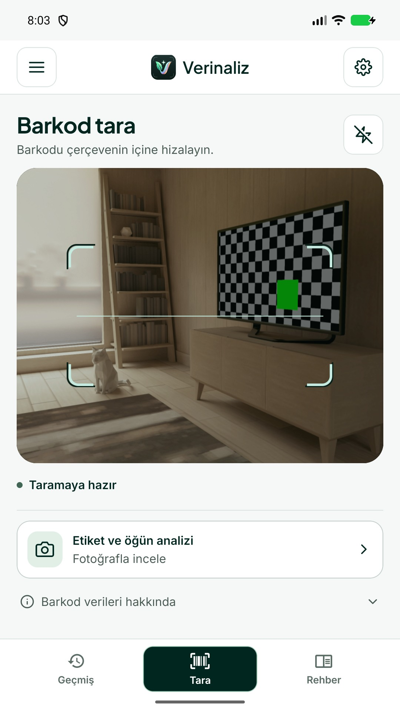
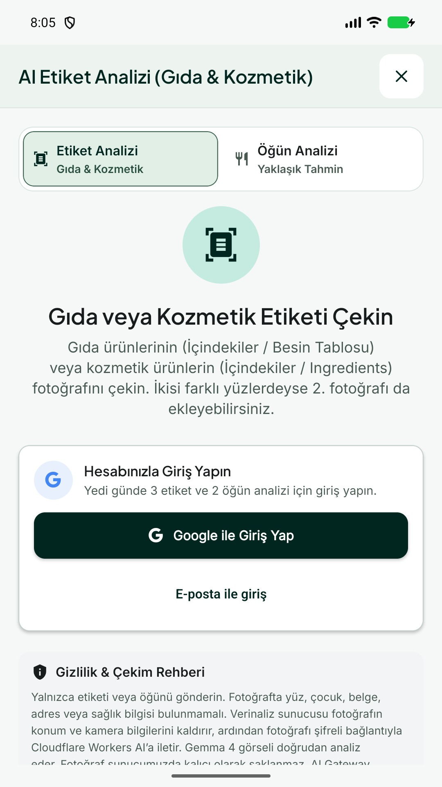
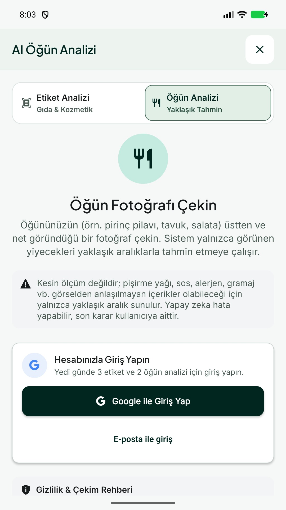
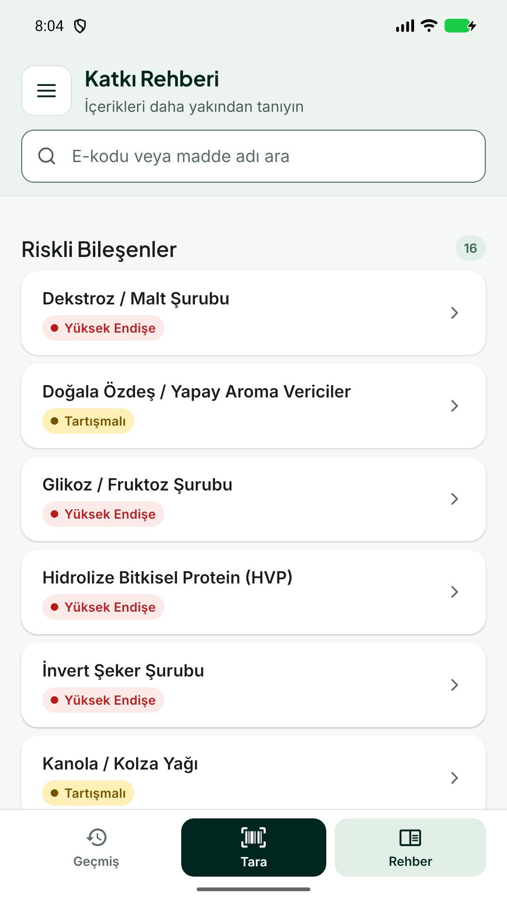

<div align="center">
  

  # Verinaliz

  **Gıda ve kozmetik ürünlerinin içeriğini daha anlaşılır kılan mobil uygulama**

  Barkod tarama · Yapay zekâ ile etiket analizi · Katkı rehberi · Kişisel geçmiş

  [](https://expo.dev/)
  [](https://reactnative.dev/)
  [](https://www.typescriptlang.org/)
</div>

## Proje hakkında

Bir ürünün ambalajında yer alan içerik, alerjen ve besin değerleri çoğu zaman hızlıca yorumlanamıyor. Verinaliz, barkodla bulunan ürün bilgilerini ve kamerayla çekilen etiketleri tek bir arayüzde özetleyerek kullanıcıya daha bilinçli seçim yapması için anlaşılır bir başlangıç noktası sunuyor. Gıda etiketlerinin yanında kozmetik içeriklerini ve öğün fotoğraflarını da analiz edebiliyor.

Uygulama bilgi amaçlıdır; alerji, sağlık veya beslenme kararlarında ambalaj bilgisi ve uzman görüşünün yerini almaz. Fotoğraftan yapılan öğün değerlendirmeleri yaklaşık tahminlerdir.

## Uygulama deneyimi

| Alan | Neler sunuyor? |
| --- | --- |
| **Barkod tarama** | Kamera ile ürün arama; bulunan ürünün içeriğini, alerjenlerini, katkılarını ve besin değerlerini inceleme. |
| **AI etiket analizi** | Gıda veya kozmetik ambalajından en fazla iki fotoğraf çekerek okunabilir içerik özeti ve dikkat edilmesi gereken bileşenleri görme. |
| **Öğün analizi** | Tek bir öğün fotoğrafından yaklaşık porsiyon ve besin değerlendirmesi alma. |
| **Katkı rehberi** | E kodlarını ve yaygın bileşenleri arama; açıklama ve risk etiketlerini inceleme. |
| **Geçmiş ve favoriler** | Barkod taramalarına ve fotoğraf analizlerine yeniden ulaşma; ürünleri favorilere kaydetme. |
| **AI sonuç bildirimi** | Analiz sonucunda görülen hatalı bilgi veya zararlı içerik için bildirim nedeni seçme. |

AI analizleri için Google ile veya önceden oluşturulmuş e-posta hesabıyla giriş ve son 7 günde hesap başına 3 etiket ve 2 öğün analizi hakkı bulunur. Barkod tarama ve katkı rehberi giriş yapmadan kullanılabilir.

## Ekran görüntüleri

| Barkod tarama | AI etiket analizi (gıda & kozmetik) |
| :---: | :---: |
|  |  |
| **AI öğün analizi** | **Katkı rehberi** |
|  |  |

## Nasıl çalışır?

Mobil uygulama barkodu okur veya kullanıcının kamerayla çektiği etiket/öğün görüntüsünü alır. Ayrı çalışan **Node.js ve Express backend**, barkod için Open Food Facts ile Open Beauty Facts verilerini sorgular; görüntü analizini Cloudflare Workers AI (Gemma 4) üzerinden yürütür. Sonuçlar uygulamada içerik, alerjen, katkı ve besin bilgisi olarak gösterilir. Yönetici paneli, AI sonuç bildirimlerinin incelenmesini sağlar.

Backend ayrıca Google ile giriş akışını Supabase Auth üzerinden yönetir, analiz kotalarını PostgreSQL'de izler ve API isteklerine hız sınırı uygular. Ürün sorgulama, giriş ve AI analizi için erişilebilir bir backend servisi gerekir; backend kaynak kodu ayrı bir özel depoda tutulur.

## Tasarım ve teknik yaklaşım

- **Tek arayüzde iki keşif yolu:** Barkodu olan ürünler doğrudan aranıyor; etiketi okunması gereken ürünlerde kamera tabanlı analiz devreye giriyor.
- **Açıklanabilir sonuçlar:** Katkılar, alerjenler ve besin değerleri ayrı bölümlerde gösteriliyor. Risk renkleri hızlı taramayı kolaylaştırıyor; tek başına tıbbi hüküm olarak sunulmuyor.
- **Yerel geçmiş:** Tarama ve analiz kayıtları cihazda tutuluyor. Mobil oturum belirteçleri Expo SecureStore ile saklanıyor.
- **Gönderim öncesi fotoğraf kontrolü:** Mobil uygulama kareyi cihazda kırpar ve insan görüntüsü ile kişisel bilgi işaretlerini tarar. Kullanıcı onay verirse kırpılan kare, sunucu üzerinden Cloudflare Workers AI (Gemma 4) hizmetine iletilir. Sunucu fotoğrafı geçici bellekte işler.

## Teknolojiler

| Katman | Teknolojiler |
| --- | --- |
| Mobil uygulama | Expo, React Native, TypeScript, Expo Router |
| Kamera ve yerel veri | Expo Camera, SecureStore, AsyncStorage |
| Sunucu | Node.js, Express, REST API, yönetici paneli (ayrı özel depo) |
| Veri ve kimlik doğrulama | Supabase PostgreSQL, Supabase Auth, Google OAuth |
| Ürün verisi ve AI | Open Food Facts, Open Beauty Facts, Cloudflare Workers AI (Gemma 4) |
| Dağıtım | EAS Build ve expo-updates |

## Yerel geliştirme

Node.js 22.13 veya üzeriyle bağımlılıkları yükleyin ve backend adresini ayarlayın:

```bash
npm ci
cp .env.example .env.local
npm start
```

`.env.local` içindeki `EXPO_PUBLIC_API_URL`, erişilebilir bir Verinaliz backend adresi olmalıdır. Backend kodu public olarak paylaşılmadığından bu depo tek başına ürün sorgulama, giriş ve AI analizi servislerini sağlamaz. Android, iOS ve web geliştirme komutları için `npm run android`, `npm run ios` ve `npm run web` kullanılabilir.

PowerShell’de örnek ortam dosyasını `Copy-Item .env.example .env.local` ile kopyalayabilirsiniz. Mobilde Google ile girişi denemek için bir geliştirme derlemesi veya önizleme APK’sı gerekir.

Kod kontrolleri için `npm test`, `npm run lint` ve `npx tsc --noEmit` çalıştırılabilir. `npm run verify:android`, Android izinlerini ve yayın yapılandırmasını denetler. Üretim API adresi verilirse HTTPS kullanıldığını da doğrular.

Fotoğraf kırpma ve tarama, Android’de paketlenmiş ML Kit modellerini, iOS’ta Vision’ı kullanan yerel Expo modülüne bağlıdır. İlk çalıştırma için `npx expo run:android` veya macOS’ta `npx expo run:ios` ile uygulamayı derleyin. Fotoğraflı analiz, tarama modülü bulunan mobil derlemelerde açılır.

## Yayın yapılandırması

Expo, yerel `app.json` dosyası yoksa portföydeki `app.example.json` ile çalışır. Kendi EAS projenizi bağlamak için `app.example.json` ve `eas.example.json` dosyalarını sırasıyla `app.json` ve `eas.json` olarak kopyalayıp yapılandırın. Git bu yerel dosyaları yok sayar. Bulut derlemelerinde istemci değişkenlerini ilgili EAS ortamına tanımlayın. API adresi ve iletişim bilgileri derlenen uygulamada görülebilir. [Expo yapılandırması](https://docs.expo.dev/workflow/configuration/) · [EAS derleme arşivi](https://docs.expo.dev/build-reference/easignore/)

Gizlilik politikası ve kullanım koşullarını aktarmak için yayıncı, veri sorumlusu ve destek adresi değerlerini `.env.local` dosyasına girin ve `node scripts/sync-legal-pages.cjs <backend-dizini>` çalıştırın. Betik önce yerel yayın belgelerini, onlar yoksa portföydeki şablonları kullanır.

## İlgili belgeler

- [Tasarım sistemi](docs/DESIGN.md)
- [Gizlilik politikası şablonu](docs/PRIVACY_POLICY.example.md)
- [Kullanım koşulları şablonu](docs/TERMS_OF_SERVICE.example.md)

## Lisans

[MIT](LICENSE)
